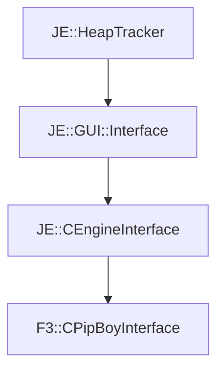

# F3::CPipBoyInterface

[Return to `F3`](/docs/f3.md)

## C++

- [`CPipBoyInterface.hpp`](/src/f3/CPipBoyInterface.hpp)
- [`CPipBoyInterface.cpp`](/src/f3/CPipBoyInterface.cpp)

## References

- [`JE::HeapTracker`](https://github.com/OpenJE/openje/docs/je/HeapTracker.md)
- [`JE::GUI::Interface`](https://github.com/OpenJE/openje/docs/je/GUI/Interface.md)
- [`JE::CEngineInterface`](https://github.com/OpenJE/openje/docs/je/CEngineInterface.md)

## Inheritance

[Return to `F3`](/docs/f3.md)

---

**T-079 / I1 annotation (2026-10-22, from `discoveries/2025-10-21-t072-doc-errata-sweep.md` §4):** the
mermaid graph above models the PORT hierarchy only. The shipped relation is **COMPOSITION, proven**:
`JE::CEngineInterface::ctor_0x580330` constructs the object INTO hosts at `[host+DISP]` — 33 direct call
sites, re-counted from raw E8 rel32 against `$OPENVB_ORIG_EXE` at apply time (T-079 ledger) — across >=27
named hosts (T-057), and vft `0x69A95C` carries exactly ONE RTTI COL at `[0x69A95C-4] = 0x6D6510` with
`primaryOffset = 0` (both dwords raw-read at apply), which a non-primary base could not share. Base-
subobject reading: **CLOSED falsification** (T-057; T-064 [B] falsified a second base-reading for the
-0xB0/-0xC4 bands, item-44). CEngineInterface is a cursor/event FACADE, 3 overrides + 3 `ret`-defaults
(T-061, vft body raw-checked: slot1 = GUI::Interface 0x4953c0, slots 3/4 = `0x404b70`). Graph kept visible
per the board state rule.
