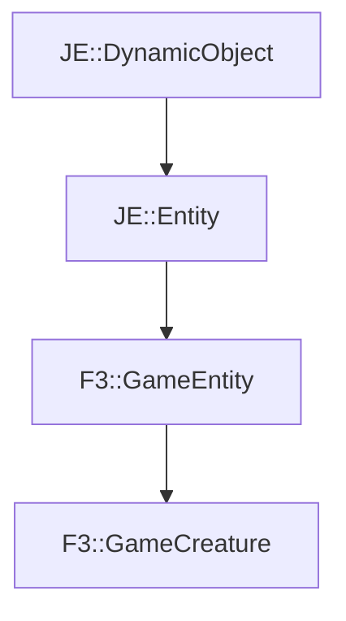

# F3::GameCreature

[Return to `F3`](/docs/f3.md)

## C++

- [`GameCreature.hpp`](/src/f3/GameCreature.hpp)
- [`GameCreature.cpp`](/src/f3/GameCreature.cpp)

## References

- [`JE::DynamicObject`](https://github.com/OpenJE/openje/docs/je/DynamicObject.md)
- [`JE::Entity`](https://github.com/OpenJE/openje/docs/je/Entity.md)
- [`F3::GameEntity`](/docs/f3/GameEntity.md)

## Inheritance

[Return to `F3`](/docs/f3.md)
## COORDINATOR ANNOTATIONS (T-078, SwiftMoon raw adjudication, applied 2026-10-21)
§1.2 failsafe record: mechanism+address STILL-TRUE (name token IS byte_64D7D8, assigned
0x40db1a/0x40db23) — ANNOTATE: token content = **"" (the failsafe unarmed mode is NAMELESS** —
pooled empty string). Cross-cite re-anchored: "ctor uses at 0x40d286" is a numeric rep-stos default
block (ctor body 0x40d010..0x40d300 has ZERO 0x64D7D8 refs); the ctor-chain "" seed is **0x40ee89**
(push ""; call 0x401d20), reached via the sub-object thunk 0x40d300 (`sub ecx,[ecx-4]; jmp 0x4e0f40`
chain per doc §3). v15=97/v16=888 seeds re-confirmed byte-true @0x40daae (0x61) / 0x40db03 (0x378).
