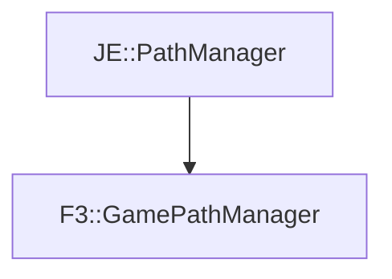

# F3::GamePathManager

[Return to `F3`](/docs/f3.md)

Reverse-engineering notes from the original `F3.exe` (database `artifacts/F3.exe.i64`).
Analyzed 2026-10 by RE session (read-mostly; renames persisted in the original IDB).

## C++

- [`GamePathManager.hpp`](/src/f3/GamePathManager.hpp)
- [`GamePathManager.cpp`](/src/f3/GamePathManager.cpp)

## References

- [`JE::PathManager`](https://github.com/OpenJE/openje/docs/je/PathManager.md)

## Inheritance

## Layout

`sizeof(GamePathManager) == 0x10` — identical to the base `JE::PathManager`; the class adds
**no data members**, only behaviour overrides. Members at 0x4/0x8/0xc seen in `F3.json` are the
base fields:

| Offset | Base field | Meaning (reconstructed) |
|-------|-----------|-------------------------|
| 0x0   | vftptr    | vftable (derived: `0x6602e4`, base: `0x696388`) |
| 0x4   | mbr_0x4   | pointer to node container (tree/sentinel list built by `sub_56E0B0` in ctor `0x560b80`) |
| 0x8   | mbr_0x8   | element count (`= ctor_56E0B0(&mbr_0x4)` result) |
| 0xc   | mbr_0xc   | second container word, zeroed in ctor, freed/zeroed in dtor `JE_PathManager_dtor_0x560bb0` |

## Construction / lifetime

- Factory: `F3_GameWorld_CreatePathManager_0x46f9e0` — **vft[7] of the `GameWorld` vftable**
  (`0x6685a4`): `operator new(0x10)` + `GamePathManager::ctor_0x45ba40`.
- `ctor_0x45ba40` calls `JE::PathManager::ctor_0x560b80`, then re-installs the derived
  vftable `0x6602e4`.
- Deleting destructor: `0x45baf0` (dtor `0x45ba60` + conditional `operator delete`).

## Vftable `0x6602e4` (derived) vs base `0x696388`

| Slot | Derived | Base | Role |
|------|---------|------|------|
| 0 | `F3_GamePathManager_Distance_0x45ba70` | `JE_PathManager_Distance_0x5604a0` | 2D distance `IntSqrt(dx²+dy²)` (`sub_5601F0` = **JE::IntSqrt**, digit-by-digit integer sqrt; renamed in IDB). Derived slot 0 is a pure tail-call delegate. |
| 1 | `F3_GamePathManager_PathCostCheck_0x45bb10` | `JE_PathManager_DistanceDispatch_0x5604d0` (calls vft[0] with two point structs) | Segment obstacle/cost pass: runs base distance, then spatial-queries entities along the segment and applies blocking rules (below). Blocked candidates hit a penalty store at `*(node + 32765dwords)`. |
| 2 | `F3_GamePathManager_CanTravel_0x45bc90` | `JE_PathManager_TraceSegmentClear_0x562600` | 3D straight-line travel test (see below). If clear, falls through to the base segment trace, which per-entity calls **vft[3]**. |
| 3 | `F3_GamePathManager_CheckEntityClearance_0x45ba90` | `JE_PathManager_Meth_AlignCheck_0x560480` (`(flags & 0xF) == 0`) | Per-entity clearance gate. RTTI-casts to `GameEntity`, reads type at `entity+6`; thresholds: type≤3 → size≥0x2B, type==4 → ≥0x20, type==5 → ≥0x15, type≥6 → ≥0xA. Bigger creatures need more clearance. `TraceSegmentClear` returns 0 if any sampled entity fails. |
| 4 | `F3_GamePathManager_dtor_deleting_0x45baf0` | — | scalar deleting destructor |

## Spatial query helper (`cls_0x405f80`)

`JE_SpatialGrid_QueryEntities_0x405f80` (also variant `meth_0x561a90` for the base trace):
enumerates entities in a rectangular cell span of the map grid (members 0x0/0x4 = grid
width/height in cells), appending entity nodes into an output container via callback
`0x405ec0`. Called with `*(map+364)+12` (the map's grid object), query origin from
`*(*(...)+84)` (entity-vft slot 21) fed by `map+492`, and world→cell conversion `sub_560680`.

## Blocking rules applied along a path (both slot 1 and slot 2 share these)

Entity "kind" read at `entity+0x21C` (`JE::Entity::mbr_0x21c`):

- kinds **1, 2, 4** (creatures/objects?): block only if `map+820` flag is set **and**
  `JE_EntitySet_Contains_0x54aeb0(map, entity) == 1`. Despite IDA's old `net::critical::section`
  class label, `0x54aeb0` is a plain **sentinel-list/set membership test**: walks the container at
  `map->mbr_0x330` (node payload at `node+8`) comparing against the entity pointer.
- kind **3** = `GameDoor`: `F3_GameDoor_IsOpen_0x40e5a0(door)` — open iff `door.mbr_0xbd == 0`
  (no lock state) or the door's lock/registry object at `door+360` answers vft[+20] with 1 when
  queried with `door + 196` (lock/key anchor). Slot 1 blocks when `!IsOpen`; slot 2 checks a door
  byte flag at `door[188]` instead.
- other kinds: ignored.

## Sampling math (slot 2 `CanTravel`, base `TraceSegmentClear`)

- `d = IntSqrt((x2−x1)² + (y2−y1)²)` (z delta tracked but not in the sqrt).
- `steps = ceil-ish(d * 1.666)` — pace factor **5/3**; if `steps ≤ 1` the segment is
  trivially clear (base returns 1; derived skips straight to base).
- Sample points at `t = i/steps`, i = 1..steps−1: `p = p1 + (p2−p1)·t`, spatial query
  around each sample, evaluate the blocking rules / clearance gate per hit.

## Container / helper internals (second pass)

- PathManager `mbr_0x4` container: RB-tree; header sentinel is a 12-byte self-linking node from
  `JE_RbTree_InitSentinel_0x56e0b0` (value nodes are 0x14 via `JE_RbTree_NodeAlloc14_0x56e2b0`,
  color byte at +0x10, sentinel flag at +0x11; entity payload at node+0xC). Base
  `TraceSegmentClear` uses the 0x10-node variant (`JE_RbTree_NodeAlloc10_0x560940`, flags at
  +0xD/+0xE, payload at +0xC too — per-entity callback receives `node+12`).
- World→cell transform: `JE_WorldToOctreeCell_0x560680(out, point, map)` — calls
  `JE::Map::GetOctree_0x56d960`, octree vft[+20] returns bounds (min.xyz at [0..2], max.y at [1]?
  max.z at local_18[2], max.x at local_18[3]), then normalizes:
  `col = (x - minx) / (maxx - minx) * map.mbr_0x84[0]` and
  `row = -((z - maxz) / (maxz - minz) * map.mbr_0x84[1])` (z-axis maps to row; float→int
  truncation). `map.mbr_0x84` = octree cell dimensions (w,h).
- Spatial grid sources: slot 1 uses `map+364 + 12`; base trace uses `mover+76` with grid variant
  `meth_0x561a90`, derived CanTravel uses `mover+80` (`entity+64/68/80` = position floats feeding
  the query).
- `F3::GetWorldServerInstance_0x401150` — the `global_cls_0x616328_0x70bd98` singleton accessor
  (active world/session). Related: `JE::ActionMoveTo::virt_meth_0x55b4f0` (0x55b4f0) allocates a
  0x60-byte move-request object (`cls_0x560390`, ctor `0x560390(map, x, y, z, 0,0,0)`) and
  registers it with the world server via vft[+100] (`sub_561B90` at 0x561b90) — the A* job queue,
  worth a follow-up pass.

## Open questions

- ~~Slot-3 (`CheckEntityClearance`) arg mapping~~ **RESOLVED**: the "type" is `GameEntity` dword at
  byte **0x18** (IDA showed void* cast `+6` = dword index 6 = 0x18). Evidence: `GameEntity::ctor_0x4678a0`
  sets `mbr_0x18 = 4`; `GameCreature::ctor_0x40d010` sets 0; `GameDoor::ctor_0x40e7f0` writes 3 to the
  same slot. Runtime class enum {≤3, 4 generic, 5, ≥6}, distinct from the 1000-based .grp ftypes
  documented in van-buren-docs/File-Format-Specifications.md.
- Units of the clearance thresholds (43/32/21/10) — presumably movement size in engine units; correlate
  with `GameCreature` size/radius fields when GCRE RE lands.
- `JE::GUI::Interface::meth_0x405950 / 0x405c20 / 0x4b9d60` labels are misattributions — from
  context they are RB-tree insert/clear helpers operating on the node containers.

## The consumer: time-sliced A* (`JE::PathManager::ProcessJobs_0x563090`)

> **Naming/identity update:** the "steerer" object (`cls_0x560c00`) **is the PathManager
> itself** - `world+0xF0` stores the manager; its `+8/+0xC` pair (previously "result
> container/count") is the pending-job list {sentinel, count}; `JE::World::ServerUpdate_0x545d60`
> pumps `ProcessJobs()` once per frame with a 90 ms budget. Function names in the IDB were
> corrected (ProcessJobs/StepNeighbor/TryStraightSlide/SmoothPath are `JE::PathManager::`
> members). The reimpl now executes this algorithm end-to-end (tests: direct fast path, empty
> grid A*, OOB rejection).

Call chain: `JE::World::virt_meth_0x545d60` (server tick) → `JE_PathSteerer_ProcessJobs_0x563090(
this->World.mbr_0xf0)` — a `cls_0x560c00` **PathSteerer** with layout `{+0 policy vftptr-like ptr,
+8 job-list header, +12 job count}`. The policy pointer (`cls_0x560c00.mbr_0x0`) **is the
GamePathManager object**: its vtable slots are consumed as the A* policy interface —

| policy slot | GamePathManager method | A* role |
|-------------|------------------------|---------|
| vft[0] | `Distance_0x45ba70` | heuristic h (also per-cell `(*vft+0)(steerer, col,row, goalCol,goalRow)` in scoring) |
| vft[+4] (slot1) | `PathCostCheck_0x45bb10` | edge cost g between neighbor and current (`(*(vft+4))(steerer,&out,neighbor,current)`) |
| vft[+8] (slot2) | `CanTravel_0x45bc90` | direct start→goal line test; if clear, path = [goal, start] only |
| vft[+12] (slot3) | `CheckEntityClearance_0x45ba90` | per-candidate-cell entity gate inside neighbor stepping (`(*(policy+12))(pm, entityByte, mover->map)`) |

Algorithm (per job, resumed across frames):

1. `JE_PathSteerer_TryStraightSlide_0x5628e0`: bounds-check target vs octree extents; convert
   start (`job+0x20..0x28`) and goal (`job+0x2C..0x34`) via `JE_WorldToOctreeCell_0x560680` into
   `job+0x10/0x14` (start cell) and `job+0x18/0x1C` (goal cell); reject if
   `JE_Map_IsCellInvalid_0x54ae60(map, goalCell)`. Computes an **8-way octant direction code**
   (0–7) from the column/row sign combos; queries entities along the goal segment
   (`meth_0x561a90` grid variant); if any entity fails clearance, retries with `StepNeighbor`
   up to **10 slides** before giving up. Failure ⇒ job status 2.
2. Grid is **coarsened by 3**: `JE_PathSteerer_StepNeighbor_0x560c00(dir 0..7)` offsets cells by
   ±3 (8-neighbor, all diagonals allowed); goal is “reached” when within **±3 cells** on both
   axes. Node pool covers 10000 cells (`operator new(0x3A980)` = 24 bytes × 10000, ctor via
   `ProcessWithCallback_0x4010A0` + `JE_NodePool_GetNode_0x562f90`).
3. Open list = min-heap keyed on `node+16` (f = g+h): `JE_OpenHeap_Push_0x562550`,
   `JE_OpenHeap_Pop_0x560e40` (swap-last + `JE_OpenHeap_SiftDown_0x560890`),
   `JE_OpenHeap_SiftUp_0x560aa0`, `JE_OpenHeap_Empty_0x560650`. Node (24 B):
   `{+0 col, +4 row, +8 parent*, +12 g?, +16 f, +20 inOpen, +21 inClosed}`.
4. Expansion: for each of 8 dirs, skip if node already parented there; tentative cost =
   parent chain + `policy vft[+4]` edge cost + `policy vft[+0]` heuristic; relax (update f and
   re-sift) if better.
5. **Time slice**: if `JE_TickMilliseconds_0x56af50() - job.startMs > 0x5A` (**90 ms/frame**),
   return mid-search; state persists in the job and resumes next tick.
6. On reaching goal: walk parent chain (`node+8`), `JE_CellToWorld_0x560710` each cell,
   push into `JE::WaypointList` (`cls_0x56f440`, `JE_WaypointList_Push_0x5619d0`) at `job+0x04`;
   if >3 waypoints, run `JE_PathSteerer_SmoothPath_0x561fa0` (string-pull). Status 1 = done.
7. `ActionMoveTo` consumer (`virt_meth_0x55b600`): reads status (`job+0` 0=pending/1=ok/2=fail),
   interpolates along waypoints at `speed = dist*(dt_ms*0.001)` (units/second), yaws via
   `acos(...)·57.295776` deg, and re-issues a job when the target moved >20 units and ≥**2000 ms**
   since the last request.

### PathJob runtime fields (used by the steerer; byte offsets)

| Off | Field |
|-----|-------|
| 0x00 | status: 0 pending, 1 success, 2 fail |
| 0x04 | WaypointList (cls_0x56f440) result |
| 0x08 | search start timestamp (ms) |
| 0x0C | mover object (map at +12, grid at +76) |
| 0x10/0x14 | start cell col/row |
| 0x18/0x1C | goal cell col/row |
| 0x20–0x28 | start xyz (world floats, copied from mover+4/8/0xC) |
| 0x2C–0x34 | goal xyz |
| 0x38 | init flag byte |
| 0x3C | node pool (24B × 10000 cells) |
| 0x44 | open heap (cls_0x562460) |
| 0x48 | closed set (freed via sub_562BF0/sub_5B3500) |
| 0x4C–0x54 | grid dims from `map+0x84…` (octree cell w/h/depth) |
| 0x5C | slide-allowed flag (ctor param_5) |

## Move-request object (`cls_0x560390` → `JE::PathJob`, size 0x60)

Created by `JE::ActionMoveTo::virt_meth_0x55b4f0` (0x55b4f0) and pushed onto the world-server's
path queue via `JE_PathJobQueue_Push_0x561b90` (linked append, node alloc `sub_433760`;
erase via `JE_PathJobQueue_Erase_0x560b10`). Ctor copies mover position (`mover+4/8/0xC`),
target xyz, and grid dims from `map+0x84…` (via world-singleton vft[+84] with `mover+492`→map).
Runtime fields are tabulated above; `JE_PathJob_Reset_0x562e90` erases from queue and frees
pool/heap/closed-set/waypoints. ActionMoveTo re-requests after 2000 ms when the target drifts
>20 units. Note `sub_560490` @ 0x560490 is the node-pool element ctor (via
`ProcessWithCallback_0x4010A0`, 10000 × 24 B).

## Global state used

- `F3::global_cls_0x616328_0x70bd98` — world/session singleton accessor (function `0x616328`);
  path code dereferences `*(singleton[2] + *[singleton[2]] + 4)` then calls vft[21] (+84)
  with `entityOwner+492` to resolve the active map/grid.
- Map object fields used: `map+364` (spatial grid), `map+492`, `map+820` (net-collision flag).

## Reimplementation mapping

- `F3::GamePathManager` (`src/F3/GamePathManager.hpp`): rename `virt_meth_0x45ba70` →
  `Distance`, `virt_meth_0x45bb10` → `PathCostCheck`, `virt_meth_0x45bc90` → `CanTravel`,
  `virt_meth_0x45ba90` → `CheckEntityClearance`, `virt_meth_0x45baf0` → deleting dtor.
- `JE::PathManager` (`modules/openje/src/JE/PathManager.hpp`): needs the 4-slot vft
  (`Distance`, `DistanceDispatch`, `TraceSegmentClear`, `AlignCheck`), IntSqrt, the pace
  factor 1.666, and the node container built by `sub_56E0B0`/`sub_560940`.
- Note: derived class replaces base slot 3 semantics entirely (align-check → clearance gate);
  base `TraceSegmentClear` calls slot 3 virtually, so the F3 behaviour is what matters for the demo.

[Return to `F3`](/docs/f3.md)
